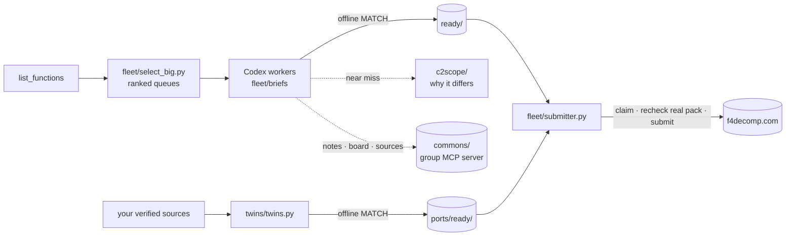

<div align="center">

# f4decomp-toolkit

**Agent tooling for byte-matching Fallout 4 on [f4decomp.com](https://f4decomp.com)**

Offline-first match queues · twin porting · a model-free submitter · compiler tracing · a shared commons for your group

[](LICENSE)


</div>

---

These are the tools one f4decomp account built and runs on Day 1 of the project. They wrap the site's own
**f4check** kit (not included: it ships with every packet) and assume you have your own copy of the 1.10.163
executable. Nothing here contains game bytes, disassembly or Microsoft files.

> **What it did for us (2026-11-21, measured):** 5,004 verified submissions on the first day with no failed
> verification and no strike; then 1,488 extra offline matches from twin porting in about four minutes, with no model
> involved; large-function lanes averaging about 870 bytes a match against 35 bytes for small-function volume.

## How the pieces fit



The rule behind all of it: **match offline first, claim only what already matched, recheck against the real pack,
and end every claim at once.** The daily cap (5,000 on the swarm tier) is the bottleneck, so bytes per submission is
what counts.

## What's inside

| Folder | What it does | Highlights |
|---|---|---|
| [`twins/`](twins/twins.py) | Hashes every function's instruction shape (outside targets masked), then ports each of your matched sources to its open same-shape twins and checks every port offline | 245,326 functions hashed in 8 s; renames placeholders by address and swaps string literals (one 39-byte family went from 0 to 774 matches) |
| [`fleet/`](fleet/) | Offline-first lanes for Codex workers: ranked queues of open functions, local packs, worker briefs, a supervisor that restarts workers with fresh context | `select_big.py` skips third-party code (Havok, Scaleform, zlib) and known blockers; ranks untouched, named, string-bearing functions first |
| [`fleet/submitter.py`](fleet/submitter.py) | One process owns every claim and submit: largest first, claim just in time, recheck on the real pack, submit or give up with the code | Keeps margins under the daily and pending caps; pauses itself on a strike, a failed verdict or 5 errors in a row |
| [`remote-compile/`](remote-compile/) | A drop-in `msvc11.py` replacement that compiles on another host over SSH (Wine), so light machines share one build box | A compile round trip takes a few seconds |
| [`c2scope/`](c2scope/) | A wrapper and symptom guide for [c2scope](https://github.com/NoahBPeterson/c2scope), which traces the exact VC2012 x64 back end | `icount` names the source line and compiler pass behind each differing instruction |
| [`commons/`](commons/) | A token-gated MCP server (behind your existing TLS site) and Postgres for a small trusted group: notes, verdicts, a work board with expiring claims, a shape-keyed source pool | 13 bounded tools; refuses pasted bytes, listings and keys; 24 of 24 end-to-end checks |
| [`docs/insights.md`](docs/insights.md) | Our measured compiler and server findings (M-numbers) | The game is built without C++ EH although packs list `/EHsc`; VS2012 RTM, Update 2 and Update 4 compile identically |

## Quick start

```bash
# 1. a work folder with the f4check kit and your own executable
export F4WORK=~/f4work
mkdir -p $F4WORK/private && cp /path/to/your/Fallout4_1_10_163_unpacked.exe $F4WORK/private/
python3 -m venv $F4WORK/venv && $F4WORK/venv/bin/pip install capstone
# unpack f4check.tar.gz from any packet's shared_files into $F4WORK/kit/f4check
# put your API key in $F4WORK/workers/w1/key.txt (mode 600)

# 2. twin-port your own verified sources
cd $F4WORK && cp ~/f4decomp-toolkit/twins/twins.py ~/f4decomp-toolkit/fleet/select_big.py .
venv/bin/python twins.py shapes      # shape table, seconds
venv/bin/python twins.py open        # every open address (pages list_functions)
venv/bin/python twins.py port --dry  # what your templates reach
venv/bin/python twins.py port        # offline matches land in big/ports/ready/

# 3. submit what is ready, largest first, without a model
venv/bin/python ~/f4decomp-toolkit/fleet/submitter.py --dry 5
```

`twins.py` takes its templates from `workers/*/packs/<address>/` folders holding `candidate.cpp` and a `submit.json`
with a submission id (the layout our workers leave); adapt `templates()` to your own layout.

## Configuration

| Variable | Used by | Default |
|---|---|---|
| `F4WORK` | everything | `~/f4work` |
| `F4CHECK_IMAGE` | f4check | `$F4WORK/private/Fallout4_1_10_163_unpacked.exe` |
| `F4_COMPILE_HOST` | remote compile, c2scope, supervisor | `buildhost` (an SSH alias) |
| `F4_REMOTE_KIT_INCLUDE` | c2scope | `/home/$USER/f4work/kit/f4check/include` on the build host |
| `F4COMMONS_HOST`, `F4COMMONS_DNS`, `F4COMMONS_PORT` | commons server | `127.0.0.1`, `localhost`, `4410` |

## Ground rules we keep

- **No game bytes, disassembly listings, Microsoft files or keys** in git, notes or submissions. Each person uses their
  own executable.
- **Real, readable C++.** No inline assembly, no steering pragmas, no `volatile` tricks; f4check's standards lint is
  the floor.
- **Every claim ends at once**, submitted or released, so nothing lapses and nothing is held from others.
- **Credit by account.** A match made by one model is claimed under that model; ideas from other contributors are
  credited (see [PROVENANCE.md](PROVENANCE.md)).

## Status

Built and running since f4decomp's first day (2026-11-21). Expect rough edges: paths and layouts follow one setup, and
the site's API and kit change quickly. Issues and pull requests are welcome.

## License

[MIT](LICENSE). c2scope is MIT and not vendored here; the f4check kit belongs to f4decomp and is not included.
